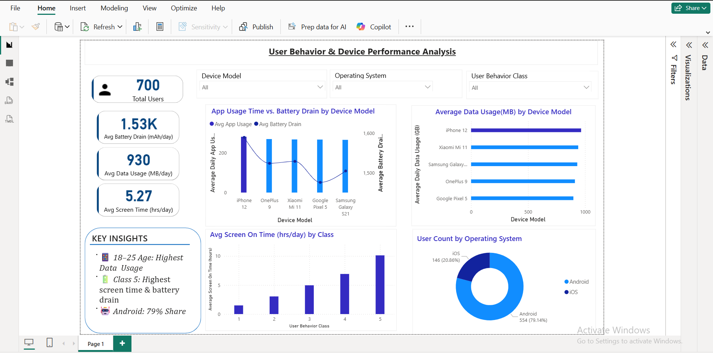

# User Behavior & Device Performance Dashboard (Power BI)

**Usage patterns vary across device models, but the dashboard focuses more on overall usage behavior than demographic differences.**

## The question
How do app usage, screen time, battery drain and data use differ by device model, operating system, age, gender and user behavior class?

## The data
- Public mobile usage dataset from Kaggle: **700 users, 11 columns**, 5 device models (4 Android, 1 iPhone), ages 18-59.
- No missing values, no duplicate user IDs.
- Per user: app usage (min/day), screen time (hrs/day), battery drain (mAh/day), apps installed, data use (MB/day), plus a **User Behavior Class** from 1 (light) to 5 (heavy).

## What I built
- Five measures: average app usage, screen time, battery drain, data use, and total users.
- Three slicers (device model, operating system, behavior class) that filter the whole page.
- Two KPI cards and four charts: app usage and battery by device, OS split, screen time by class, data use by device.

## Key findings

**1. Phone model, OS, gender and age do not explain usage.** I tested each, and every gap is within what chance would produce:

| Factor | Difference | Result |
|---|---|---|
| Device model | Avg data 898-966 MB/day across 5 models | p = 0.92 |
| Operating system | Android 920 vs iOS 966 MB/day | p = 0.45 |
| Gender | Male 944 vs female 914 MB/day | p = 0.54 |
| Age | Correlation with data use: 0.00 | p = 0.92 |

A p-value above 0.05 means the gap could easily be chance. iPhone 12 users are highest on average app time (282 min/day) and battery drain (1,590 mAh), but only by a few percent.

**2. Behavior class is what separates users.** Class 5 users use about 10 times the data of class 1 (1,975 vs 202 MB a day), 7 times the screen time and 6 times the battery.

| Class | Users | App time (min/day) | Screen time (hrs) | Battery (mAh) | Data (MB) |
|---|---|---|---|---|---|
| 1 | 136 | 30-89 | 1.5 | 455 | 202 |
| 2 | 146 | 91-179 | 3.0 | 884 | 451 |
| 3 | 143 | 181-299 | 5.0 | 1,515 | 822 |
| 4 | 139 | 301-478 | 6.9 | 2,106 | 1,232 |
| 5 | 136 | 481-598 | 10.1 | 2,701 | 1,975 |

(Averages by class. The app time column shows the full range inside each class.)

**3. By device:**

| Device | Users | App time (min/day) | Battery (mAh) | Data (MB) |
|---|---|---|---|---|
| Google Pixel 5 | 142 | 268 | 1,476 | 898 |
| OnePlus 9 | 133 | 270 | 1,524 | 911 |
| Samsung Galaxy S21 | 133 | 266 | 1,505 | 932 |
| Xiaomi Mi 11 | 146 | 269 | 1,529 | 940 |
| iPhone 12 | 146 | 282 | 1,590 | 966 |

**4. The dataset is 79% Android** (554 users) and 21% iOS (146 users). This describes the sample, not the phone market. All iOS users are on the iPhone 12, so "iOS vs Android" and "iPhone 12 vs the rest" are the same comparison.

## What this means
If this were real usage data, a phone maker or app team would be wasting effort segmenting users by device model or age. Behavior is what matters, so I would segment by how people use the phone.

## Data limits
- **The behavior class is built from the usage columns.** Each class sits in its own band on all five measures with no overlap (for example, app time of 30-89 min is always class 1 and 481-598 min is always class 5). So the steep rise across classes is by design, not a discovery, and the useful result is how little device, OS, age and gender matter.
- **The data looks simulated.** Bands that clean, plus near-zero links between age, device and usage, are unusual in real phone data. Treat this as a practice project on a public dataset.
- Usage measures move together (correlations 0.93-0.96), so they carry mostly the same information.
- 700 users and one snapshot, with no dates, so there are no trends over time.

## Run it yourself
Open `User_Behavior_Analysis.pbix` in Power BI Desktop (free, Windows). On a Mac or in a browser, use the screenshot above.

## Files
- [User_Behavior_Analysis.pbix](User_Behavior_Analysis.pbix): Power BI file
- [PowerBI_Dashboard.png](PowerBI_Dashboard.png): dashboard screenshot
