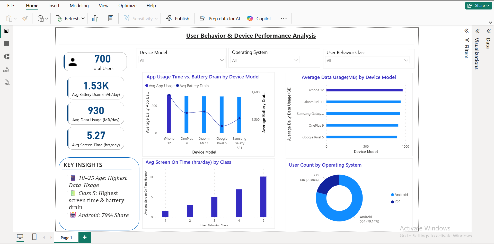

# User Behavior & Device Performance Dashboard (Power BI)

**What drives heavy phone use? In this dataset, usage habits matter far more than the device.**

## The question
How do app usage, screen time, battery drain and data use differ by device, operating system, age and user type?

## The data
- Public mobile usage dataset from Kaggle: **[add dataset name and link]**
- 700 users, 11 columns, 5 device models, ages 18-59
- No missing values and no duplicate user IDs

## Tools
Power BI: data cleaning, measures, interactive dashboard

## Key findings
| User Behavior Class | Users | Avg data (MB/day) | Avg battery drain (mAh/day) | Avg screen time (hrs/day) |
|---|---|---|---|---|
| 1 | 136 | 202 | 455 | 1.5 |
| 2 | 146 | 451 | 884 | 3.0 |
| 3 | 143 | 822 | 1,515 | 5.0 |
| 4 | 139 | 1,232 | 2,106 | 6.9 |
| 5 | 136 | 1,975 | 2,701 | 10.1 |

- **Class 5 users use about 10 times the data of class 1** and drain 6 times the battery.
- **Age:** 18-25 had the highest average data use at 977 MB a day, but the gap is small. Other age groups ranged from 807 to 958.
- **Device:** The five models are close. Average app time is 266-282 minutes a day, and battery drain is 1,476-1,590 mAh. iPhone 12 is highest on both.
- **OS split:** 554 users (79.1%) are on Android and 146 (20.9%) on iOS. This describes the dataset, not the market.

## Data notes and limits
- App time, screen time, battery drain and data use move together (correlations of 0.93-0.96), so the behavior class looks like a summary of these measures.
- Device and age differences are small next to the behavior class differences.

## Files
- [User_Behavior_Analysis.pbix](User_Behavior_Analysis.pbix) - Power BI file
- [PowerBI_Dashboard.png](PowerBI_Dashboard.png) - dashboard preview
